# LLM-as-a-Judge for Code Generation and Benchmark Quality

Code, data pipelines, and thesis source for a Master's thesis on **LLM-as-a-Judge** evaluation, applied to two complementary problems in automated software evaluation:

1. **Research Direction 1 (RD1): judging model output.** An LLM judge scores code written by other LLMs on five quality dimensions, going beyond pass/fail correctness.
2. **Research Direction 2 (RD2): judging the benchmark itself.** A panel of LLM judges audits benchmark tasks, testing whether judges can act as meta-evaluators of benchmark quality.

Both directions use the same pair of benchmarks, **HumanEval** and **HumanEvalNext** (a revised version of HumanEval), so the thesis can ask whether LLM judges notice the improvements HumanEvalNext claims to make.

> **Author:** Pragati Manandhar (Erasmus Mundus EDISS, University of L'Aquila / Åbo Akademi University)
> **Supervisor:** Thanh Phuong Nguyen (University of L'Aquila)

---

## Research questions

| ID | Question |
|----|----------|
| RQ1 | Can an LLM judge give per-dimension quality scores for generated code that a single correctness signal cannot, and how reliable is the judge internally? |
| RQ2 | Does an LLM judge detect the improvements HumanEvalNext introduces over HumanEval when it scores model-generated solutions to matched tasks? |
| RQ3 | Applied directly to benchmark instances, can LLM judges detect the same improvement, and how consistent is that judgment across different judge models? |

---

## Overview of the two frameworks

### RD1: code-generation judge

- **Candidate models (6):** StarCoder2-7B, Magicoder-S-DS-6.7B, Mistral-7B-Instruct-v0.3, DeepSeek-Coder-6.7B-Instruct, CodeLlama-7B-Python, CodeLlama-7B-Instruct.
- **Tasks:** 164 HumanEval problems and 82 HumanEvalNext problems (246 per model).
- **Generation:** 5 stochastic samples per problem per model, 4-bit NF4 quantisation.
- **Judge:** one fixed judge, `Qwen2.5-Coder-7B-Instruct`, with deterministic decoding (`do_sample=False`) so scoring is reproducible.
- **Rubric (5 dimensions):** correctness, reasoning quality, code clarity, robustness, efficiency. The judge returns structured JSON with a score per dimension and a written justification.
- **Per-problem metrics:** `avg_<dimension>`, `avg_overall`, `best_overall`, `std_overall`, `validity_rate`, `valid_count`, `diversity`, and `judge_consistency`.

Each candidate model runs in its own notebook, because a quantised candidate and the judge have to fit together in 16 GB of GPU memory.

### RD2: benchmark-quality judge

- **Judges (4):** Qwen2.5-Coder-14B-Instruct, Qwen2.5-Coder-7B-Instruct, OLMo-2-13B-Instruct, Phi-4.
- **Tasks:** 82 matched HumanEval/HumanEvalNext task pairs (164 audited instances per judge).
- **Input to the judge:** problem statement, tests, and reference solution only.
- **Rubric (5 criteria):** correctness of tests, test coverage, solution quality, problem clarity, representativeness. These are averaged into a `benchmark_quality_score`.
- **Analysis:** HumanEvalNext minus HumanEval difference per judge, Wilcoxon signed-rank tests on matched pairs, and cross-judge agreement (Pearson correlation, mean absolute difference, sign agreement).

---

## Design principles

The design follows recommendations from the LLM-as-a-Judge literature on reliability:

- Point-wise (not pairwise) scoring with deterministic decoding.
- Explicit, anchored rubrics.
- A mandatory written justification alongside every numeric score.
- Defensive JSON parsing, with failures recorded as visible, zero-scored rows instead of crashing the run.
- Multiple judge backbones in RD2, so a conclusion does not rest on one judge's quirks.
- Incremental checkpointing and detailed logs, so a run can resume and every prompt/output pair can be traced.

---

## Repository layout

Adjust the code folders to match your final structure.

```
.
├── rd1_code_generation_judge/         # one notebook per candidate model
├── rd2_benchmark_quality_judge/       # one script per judge backbone
├── analysis/
│   ├── generate_thesis_results.py     # builds all result tables from the raw Excel outputs
│   ├── combine_rd2_judges.py          # merges per-judge RD2 outputs
│   ├── visualize_rd1.py               # RD1 figures
│   └── visualize_rd2.py               # RD2 figures
├── figures/
│   ├── rd1/                           # figures shown in the Results section
│   └── rd2/
├── results/                           # summary tables as CSV
├── data/                              # raw model outputs (see "Output files")
└── thesis/                            # LaTeX source of the thesis
```

---

## Setup

### Requirements

- Python 3.10+
- An NVIDIA GPU. The experiments were run on a single **Tesla V100 16 GB** with PyTorch 2.5.1 (CUDA 12.1).
- Hugging Face access to the model weights. Some models may need you to accept a licence and log in (`huggingface-cli login`).

### Install

```bash
pip install torch transformers datasets accelerate bitsandbytes
pip install pandas openpyxl numpy scipy matplotlib
```

Add a `requirements.txt` with pinned versions once you have confirmed the exact versions used.

---

## Running the experiments

### RD1

1. Open the notebook for the candidate model you want (each notebook loops over both HumanEval and HumanEvalNext).
2. Run all cells. The notebook generates 5 candidates per problem, filters out invalid ones, scores the valid ones with the Qwen judge, and writes the outputs below.

**Judge token budget:** the judge's `max_new_tokens` must be large enough (1024 is used) for the full JSON response. If it is too small, the response is cut off, JSON parsing fails, and the fallback records zero scores. This happened in earlier runs of four notebooks and was fixed.

### RD2

Each judge backbone has its own script. Run the script for each judge, then merge:

```bash
python LLmasajudgeQwen7B_benchmarkevaluationmatchingdataset.py
# repeat for the other judge backbones
python combine_rd2_judges.py
```

### Reproducing tables and figures

```bash
python generate_thesis_results.py --input-dir data/ --output thesis_results.xlsx
python visualize_rd1.py data/ figures_rd1/
python visualize_rd2.py data/ figures_rd2/
```

The results workbook has one sheet per table in the thesis (RQ1, RQ2, RQ3, consistency, cross-judge agreement, invocation counts).

---

## Output files

For each RD1 candidate model the pipeline produces:

| File | Contents |
|------|----------|
| `HumanEvalNext_metrics_<model>.xlsx` | One row per problem (246 rows: 164 HumanEval + 82 HumanEvalNext) with the per-problem aggregates listed above. |
| `HumanEvalNext_explanations_<model>.xlsx` | One row per judged candidate: the five scores, the overall score, and the judge's explanation. |
| `log_<dataset>_<model>.txt` | Raw execution log of prompts, outputs, and parsed results. |

RD2 produces one results workbook per judge backbone, plus the merged workbook from `combine_rd2_judges.py`.

---

## Results

All numbers below are copied from the thesis evaluation chapter and are also available as CSV files in [`results/`](results/). Figures are in [`figures/`](figures/). Scores use a 0-5 scale.

### RD1: code-generation judge

**Per-dimension judged quality (mean over all 246 problems per model, RQ1).**

| Model | Correctness | Reasoning | Clarity | Robustness | Efficiency | Overall | Validity |
|-------|:-----------:|:---------:|:-------:|:----------:|:----------:|:-------:|:--------:|
| StarCoder2-7B | 2.32 | 2.30 | 2.48 | 1.83 | 2.36 | 2.26 | 0.91 |
| Magicoder-S-DS-6.7B | 2.22 | 2.19 | 2.37 | 1.73 | 2.25 | 2.15 | 0.48 |
| Mistral-7B-Instruct-v0.3 | 2.91 | 3.04 | 3.41 | 2.27 | 3.21 | 2.97 | 0.96 |
| DeepSeek-Coder-6.7B-Instruct | 3.27 | 3.46 | 3.74 | 2.33 | 3.60 | 3.28 | 0.98 |
| CodeLlama-7B-Python | 3.05 | 3.14 | 3.47 | 2.32 | 3.17 | 3.03 | 0.91 |
| CodeLlama-7B-Instruct | 2.55 | 2.62 | 3.00 | 1.94 | 2.77 | 2.58 | 0.59 |

Data: [`results/rd1_per_dimension_scores.csv`](results/rd1_per_dimension_scores.csv)

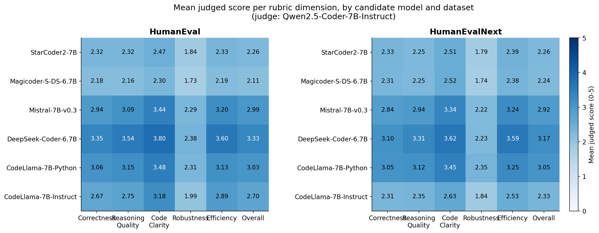
*Mean judged score per rubric dimension, per candidate model and dataset.*

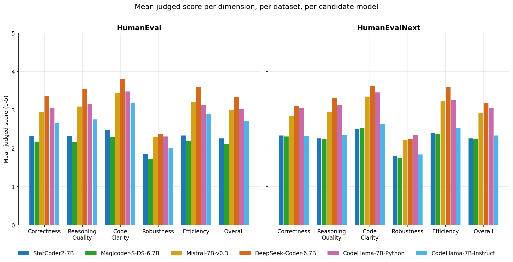
*Mean judged score per dimension, grouped by candidate model, one panel per dataset.*

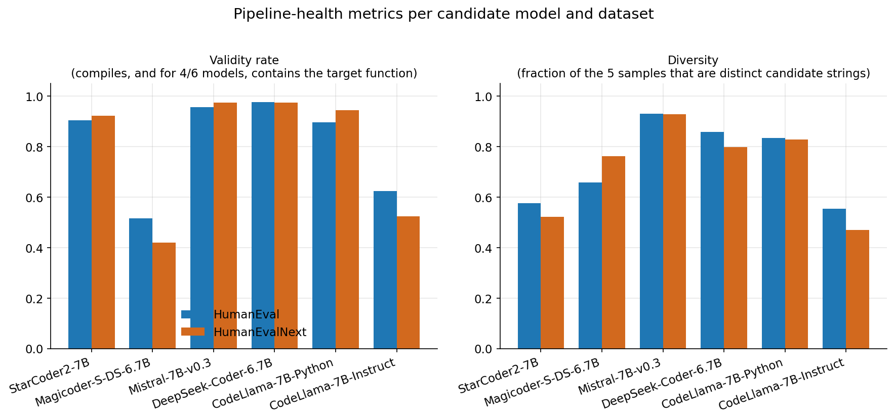
*Validity rate and candidate diversity per model and dataset.*

**HumanEval vs. HumanEvalNext, seen through model outputs (RQ2).** Mean `avg_overall` per dataset.

| Model | HumanEval | HumanEvalNext | Difference (HEN - HE) |
|-------|:---------:|:-------------:|:---------------------:|
| StarCoder2-7B | 2.257 | 2.257 | +0.000 |
| Magicoder-S-DS-6.7B | 2.110 | 2.239 | +0.129 |
| Mistral-7B-Instruct-v0.3 | 2.993 | 2.919 | -0.075 |
| DeepSeek-Coder-6.7B-Instruct | 3.333 | 3.171 | -0.162 |
| CodeLlama-7B-Python | 3.026 | 3.046 | +0.020 |
| CodeLlama-7B-Instruct | 2.698 | 2.333 | -0.365 |

Data: [`results/rd1_humaneval_vs_humanevalnext.csv`](results/rd1_humaneval_vs_humanevalnext.csv)

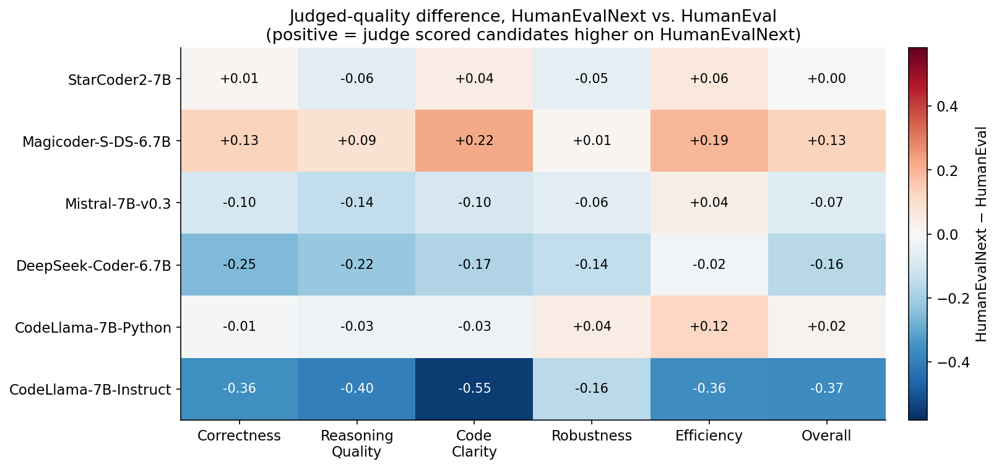
*HumanEvalNext minus HumanEval difference, per model and dimension.*

**Judge consistency.** `judge_consistency` is 0 when no candidate was valid and 1 when exactly one was valid, so the blended value is lowered or raised by those degenerate cases. The restricted value uses only problems with at least two valid candidates.

| Model | Blended | Restricted (`valid_count` >= 2) |
|-------|:-------:|:-------------------------------:|
| StarCoder2-7B | 0.90 | 0.91 |
| Magicoder-S-DS-6.7B | 0.88 | 0.99 |
| Mistral-7B-Instruct-v0.3 | 0.91 | 0.91 |
| DeepSeek-Coder-6.7B-Instruct | 0.94 | 0.94 |
| CodeLlama-7B-Python | 0.91 | 0.91 |
| CodeLlama-7B-Instruct | 0.86 | 0.90 |

Data: [`results/rd1_judge_consistency.csv`](results/rd1_judge_consistency.csv)

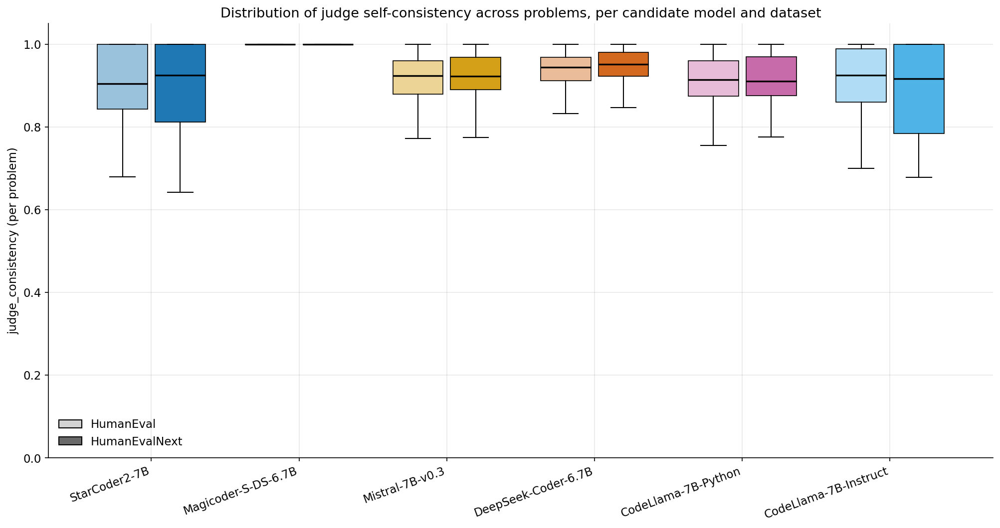
*Distribution of `judge_consistency` per model and dataset.*

Main observations for RD1:

- Robustness is the lowest-scoring dimension for all six models.
- Judged overall quality ranges from 2.15 to 3.28.
- The general-purpose Mistral model (2.97) sits close to the best code-specialised models, so code specialisation alone does not predict judged quality here.
- Across the panel, HumanEvalNext scores slightly lower than HumanEval (pooled 2.74 vs. 2.66), but two models score higher, one is unchanged, and three score lower, so there is no consistent direction.

### RD2: benchmark-quality judge

**Benchmark quality per judge (RQ3).** Mean `benchmark_quality_score` over 82 matched task pairs.

| Judge | HumanEval | HumanEvalNext | Diff. | % tasks higher on HEN | Wilcoxon p |
|-------|:---------:|:-------------:|:-----:|:---------------------:|:----------:|
| Qwen2.5-Coder-14B-Instruct | 3.78 | 3.77 | -0.01 | 24.4 | .556 |
| Qwen2.5-Coder-7B-Instruct | 3.91 | 3.89 | -0.03 | 25.6 | .580 |
| OLMo-2-13B-Instruct | 3.67 | 3.64 | -0.03 | 30.5 | .559 |
| Phi-4 | 3.56 | 3.62 | +0.06 | 37.8 | **.011** |

Data: [`results/rd2_judge_summary.csv`](results/rd2_judge_summary.csv)

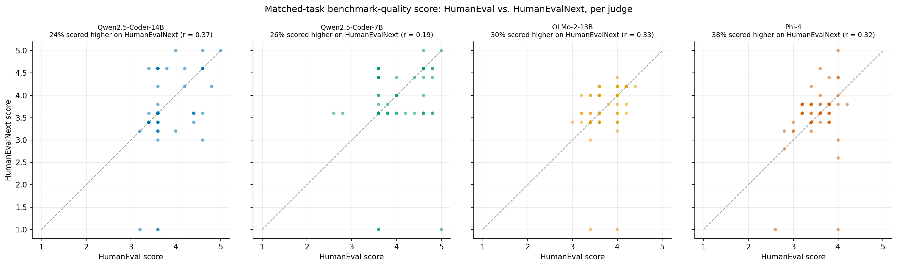
*Per-task `benchmark_quality_score`, HumanEval vs. HumanEvalNext, per judge. Points above the diagonal score higher on HumanEvalNext.*

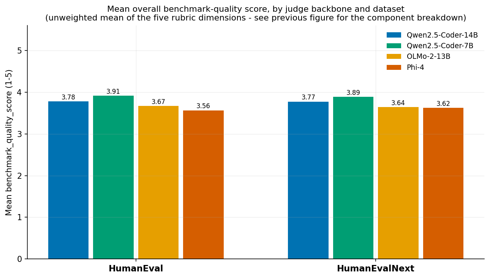
*Mean `benchmark_quality_score` per judge and dataset.*

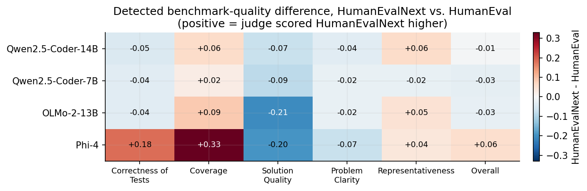
*HumanEvalNext minus HumanEval difference per judge.*

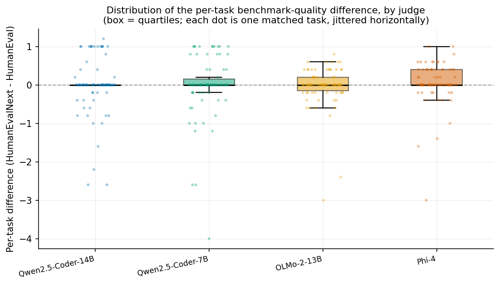
*Distribution of the per-task difference per judge.*

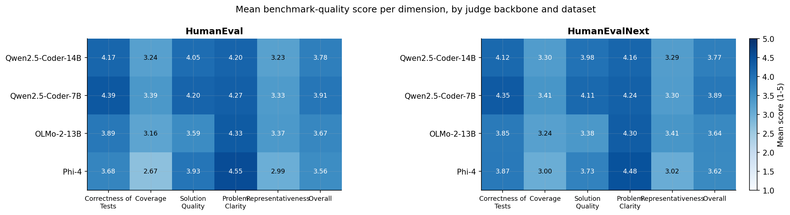
*Mean score per benchmark-quality criterion, per judge and dataset.*

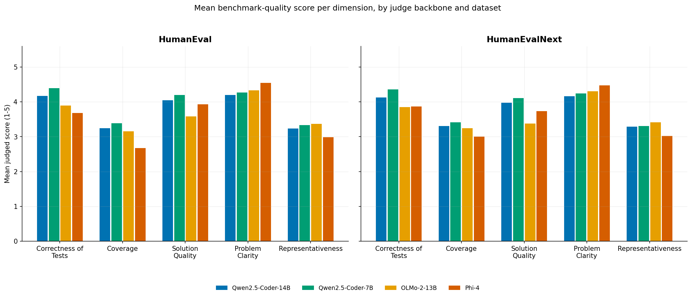
*Mean score per criterion, grouped by judge, one panel per dataset.*

**Cross-judge agreement.**

| Judge pair | r (HumanEval) | r (HumanEvalNext) | MAE (HE) | MAE (HEN) | Sign agreement |
|------------|:-------------:|:-----------------:|:--------:|:---------:|:--------------:|
| Qwen-14B vs. Qwen-7B | 0.26 | 0.85 | 0.39 | 0.27 | 59.8% |
| Qwen-14B vs. OLMo-13B | 0.12 | 0.60 | 0.36 | 0.46 | 47.6% |
| Qwen-14B vs. Phi-4 | 0.42 | 0.74 | 0.36 | 0.36 | 57.3% |
| Qwen-7B vs. OLMo-13B | 0.25 | 0.58 | 0.45 | 0.49 | 42.7% |
| Qwen-7B vs. Phi-4 | 0.38 | 0.73 | 0.49 | 0.40 | 48.8% |
| OLMo-13B vs. Phi-4 | 0.28 | 0.78 | 0.31 | 0.29 | 42.7% |

Data: [`results/rd2_cross_judge_agreement.csv`](results/rd2_cross_judge_agreement.csv)

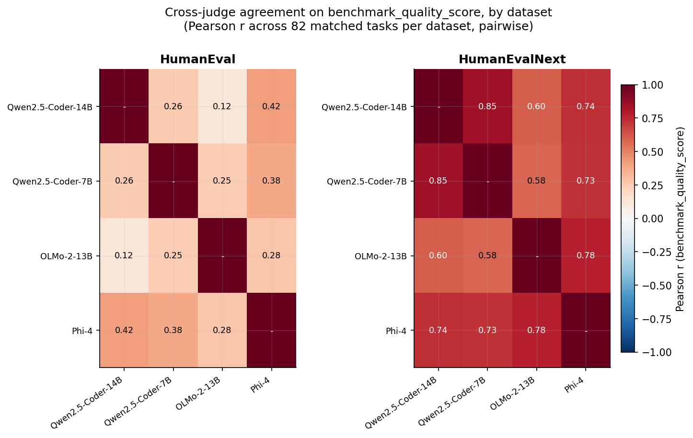
*Pairwise cross-judge agreement per dataset.*

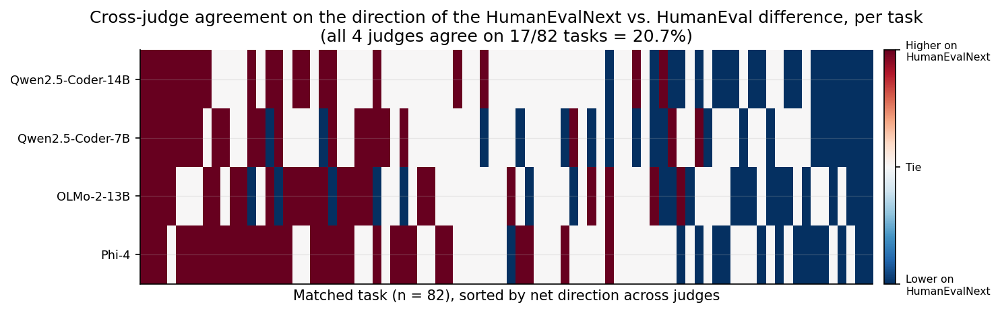
*Pairwise agreement on the direction of the per-task difference.*

Main observations for RD2:

- Three judges find small, non-significant differences with HumanEvalNext scoring lower; Phi-4 finds a small but statistically significant difference with HumanEvalNext scoring higher. The intended improvement is therefore not consistently detected.
- Agreement between judges is low-to-moderate on HumanEval (r = 0.12-0.42) and moderate-to-strong on HumanEvalNext (r = 0.58-0.85). The highest value belongs to the two same-family Qwen backbones.
- Task-level agreement on whether a task improved is only 42.7-59.8%.

Full discussion, statistical details, and caveats are in the thesis.

---

## Limitations

- No comparison against human-annotated gold-standard ratings.
- Judges in RD2 are not fully independent (two share a model family), and they ran at different numerical precisions.
- All models are in the 6–7B (candidates) or 7–14B (RD2 judges) range because of a single-GPU budget, so results should not be extrapolated to larger models.
- One benchmark-revision pair (HumanEval to HumanEvalNext), Python only, function-level tasks only.
- Scores depend on the prompt design. See the thesis appendices for the exact prompts.

---

## Citation

If you use this work, please cite the thesis:

```bibtex
@mastersthesis{manandhar2026llmjudge,
  author = {Manandhar, Pragati},
  title  = {LLM-as-a-Judge for Code Generation Evaluation and Benchmark Quality Assessment},
  school = {University of L'Aquila},
  year   = {2026}
}
```

Update the title, institution, and year to match the final submitted version.

---

## Acknowledgements and third-party resources

- [HumanEval](https://github.com/openai/human-eval) and [HumanEvalNext](https://huggingface.co/datasets/AISE-TUDelft/HumanEvalNext) benchmarks.
- Model weights from their respective Hugging Face repositories. Each model keeps its own licence.

## License

Add your chosen licence here (for example MIT) and include a `LICENSE` file. Check that it is compatible with the licences of the models and datasets you use.
